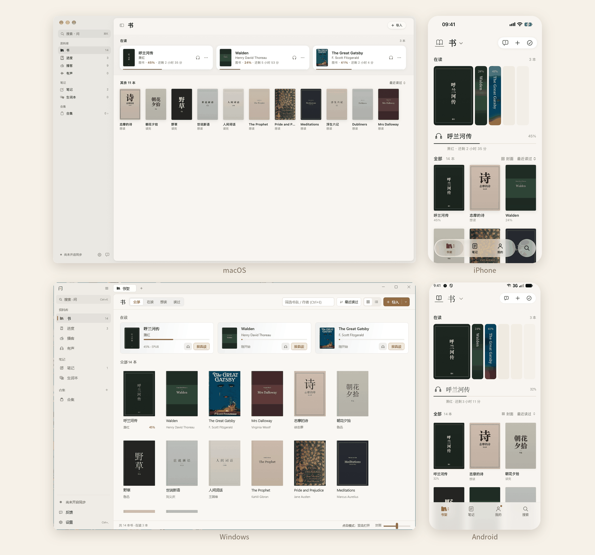
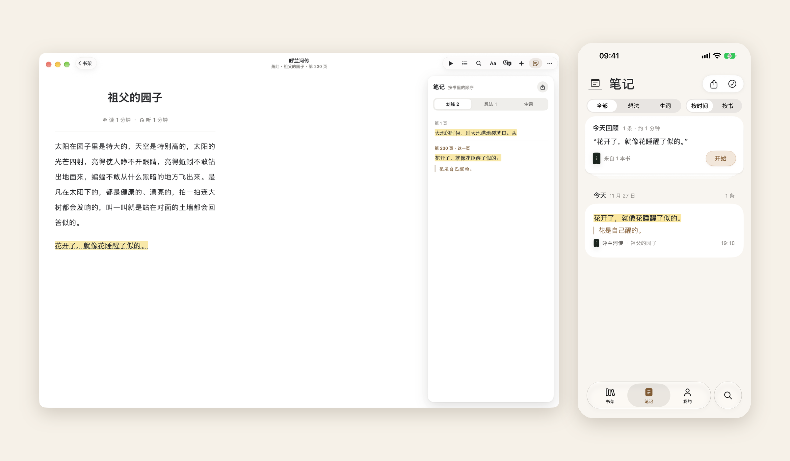
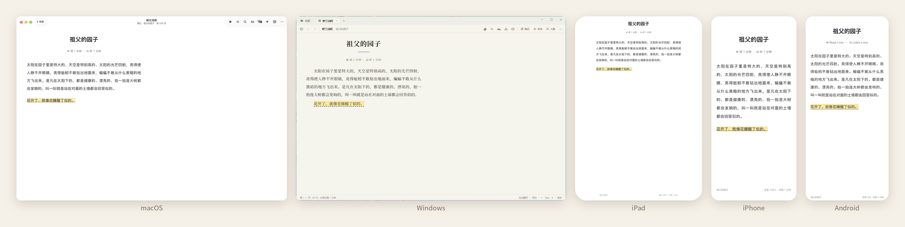

<p align="center">
  
</p>

<h1 align="center">语阅 Yuyue</h1>

<p align="center">
  读书、听书的本地阅读器，支持 Mac、Windows、Android、iPhone 和 iPad。<br />
  没有账号，不用登录，书和笔记都留在你自己的设备上。
</p>

<p align="center">
  <a href="https://cnb.cool/inokoru/yuyue/-/releases">国内高速下载</a> ·
  <a href="https://github.com/inokoru/yuyue/releases">GitHub 下载</a> ·
  <a href="#能做什么">功能一览</a> ·
  <a href="#下载与安装">安装说明</a> ·
  <a href="#给开发者">参与与构建</a> ·
  <a href="LICENSE">GPL-3.0</a>
</p>

<p align="center">
  
</p>

## 能做什么

一本书，可以看、可以听、可以记，三件事对着同一句话。

- **安静地读** — 支持 EPUB、PDF、TXT、MOBI / AZW3，多种纸张和日夜模式，翻页方式随你选；可以用局域网 Wi‑Fi 传书，也能连 OPDS / WebDAV 书库（Calibre、Kavita、Komga）。
- **读着听，听着读** — 点哪句就从哪句开始朗读，高亮跟着声音走，自动翻页；有本机离线语音（含声音克隆）、免 Key 的微软在线语音和系统声音，还有双语播客和有声书。听到一半拿起来看，正好停在同一行。
- **记下来，随时带走** — 划线、写想法、今日回顾、年度阅读热力图和书摘卡片；笔记可以导出为 Markdown、EPUB、CSV，或直接发到 Obsidian、Notion、flomo、Anki。
- **读外文原著** — 点词查释义，整句翻译，原文、双语对照、仅译文一键切换；可以导入 MDict 词典，带生词本和四六级、雅思、GRE 难词注释。
- **不剧透的 AI 书伴** — 可以用 Apple 智能、本机的 Ollama / LM Studio，或你自己的 DeepSeek、OpenAI、Claude 等 API。隔天打开有前情提要，只根据已读部分回答，每句都能点回原文。
- **不用服务器的同步** — 用你自己的 iCloud Drive 或 WebDAV（坚果云、群晖、Nextcloud 等）同步进度、笔记和书；有冲突时交给你选，不偷偷覆盖，还能整库备份成 `.yuyue` 快照。

<p align="center">
  
</p>
<p align="center">
  
</p>

<p align="center">
  
</p>

> 语阅不做账号、书城、广告和推荐流，书、进度和笔记只留在你自己的设备或网盘里。应用默认开启匿名的功能使用统计，不收集书名、笔记、划线和搜索词，可以在「关于」页关闭。还在打磨的功能见 [ROADMAP.md](ROADMAP.md)。

<details>
<summary>下载与安装</summary>

## 下载与安装

从 [国内高速镜像](https://cnb.cool/inokoru/yuyue/-/releases)（无需登录、大陆直连）或 [GitHub Releases](https://github.com/inokoru/yuyue/releases) 下载。语阅目前不上架应用商店，也没有购买商业代码签名证书，首次安装时会多一两步系统确认。现阶段 **Mac、Windows 和 Android 都可直接下载安装**（均支持应用内检查更新，国内网络优先走镜像源），iPhone 与 iPad 适合愿意自行签名的进阶用户；Linux 桌面端规划见 [ROADMAP.md](ROADMAP.md)。

### Mac（Apple 芯片 / Intel，macOS 14 及以上）

- 直接下载最新版：
  - Apple 芯片（M 系列）：[国内直链](https://cnb.cool/inokoru/yuyue/-/releases/latest/download/Yuyue-mac-arm64.dmg) · [GitHub](https://github.com/inokoru/yuyue/releases/latest/download/Yuyue-mac-arm64.dmg)
  - Intel 芯片：[国内直链](https://cnb.cool/inokoru/yuyue/-/releases/latest/download/Yuyue-mac-x86_64.dmg) · [GitHub](https://github.com/inokoru/yuyue/releases/latest/download/Yuyue-mac-x86_64.dmg)

1. 打开下载好的 `.dmg`，把语阅拖进“应用程序”。
2. 第一次打开会被系统拦下，前往“系统设置 → 隐私与安全性”，点一次“仍要打开”。

API Key 与网盘密码保存在 App 沙盒目录内的本机权限文件中（避免无开发者证书签名更新时反复弹出系统钥匙串授权），仅当前系统账号可读，不进同步、不进快照。

### Windows（64 位 x64 / ARM64，Windows 10 1809 及以上 / Windows 11）

- 直接下载最新版安装程序（x64 推荐）：
  - 安装包（`.exe`）：[国内直链](https://cnb.cool/inokoru/yuyue/-/releases/latest/download/Yuyue-windows-x64-Setup.exe) · [GitHub](https://github.com/inokoru/yuyue/releases/latest/download/Yuyue-windows-x64-Setup.exe)
  - 如需绿色免安装版（`.zip`）或 ARM64 安装包，请在 [国内高速镜像](https://cnb.cool/inokoru/yuyue/-/releases) 或 [GitHub Releases](https://github.com/inokoru/yuyue/releases) 对应版本的附件列表中下载。

1. 双击运行安装程序（默认按当前用户安装，支持 `.epub` / `.mobi` / `.azw3` / `.pdf` / `.m4b` 文件关联与后续应用内检查更新）。
2. 因暂未购买代码签名证书，首次运行若遇 Windows Defender SmartScreen 提示，点「更多信息 → 仍要运行」即可。

API Key 与网盘密码使用 Windows DPAPI（当前用户范围）加密保存在本机，不进同步、不进快照。

### Android（8.0 及以上）

- 直接下载最新版（`.apk`）：[国内直链](https://cnb.cool/inokoru/yuyue/-/releases/latest/download/Yuyue-android.apk) · [GitHub](https://github.com/inokoru/yuyue/releases/latest/download/Yuyue-android.apk)

允许浏览器或文件管理器安装未知来源的应用后即可安装。

### iPhone、iPad（iOS 17 及以上，进阶用户）

- 未签名安装包（`.ipa`）：[国内直链](https://cnb.cool/inokoru/yuyue/-/releases/latest/download/Yuyue-ios-unsigned.ipa) · [GitHub](https://github.com/inokoru/yuyue/releases/latest/download/Yuyue-ios-unsigned.ipa)

需使用 [Impactor](https://github.com/claration/Impactor) 和你自己的 Apple ID 给未签名 `.ipa` 签名安装，或使用 Xcode 从源码编译：

- 免费 Apple ID 签名的应用 **7 天后过期**，需要重新签名；
- 手机需开启开发者模式，并配合电脑操作；
- Impactor 为第三方工具，建议搭配备用 Apple ID 使用；苹果随时可能调整侧载机制，语阅无法保证此方式长期可用。

---

</details>

<details>
<summary>给开发者</summary>

## 给开发者

接下来做什么见 [ROADMAP.md](ROADMAP.md)，怎么参与见 [CONTRIBUTING.md](CONTRIBUTING.md)，多端一致性工程架构见 [docs/dev/multi-platform-architecture.md](docs/dev/multi-platform-architecture.md)。感谢 [LINUX DO](https://linux.do/) 社区的交流与反馈。

<details>
<summary>目录结构与本地构建说明</summary>

### 目录

```text
core/          Rust 核心：导入整理、断句、进度、同步等跨平台逻辑
reader/        书页（TypeScript）：在系统 WebView 中排字、分页与划线高亮
design/        设计参数（颜色、字体等）与各端代码生成脚本
apple/         iPhone、iPad、Mac 客户端（SwiftUI）
android/       Android 客户端（Kotlin + Compose）
windows/       Windows 客户端（WinUI 3 / C#）
shared/        各平台共用资源与图标
fixtures/      测试书籍、跨端共享用例（conformance）与旧版书库样本（legacy）
scripts/       开发、多端一致性审计、快照与打包发布脚本
docs/          功能对照表（parity.yaml）、截图与开发/测试文档（docs/dev/）
e2e/ & tests/  基于 Midscene 的跨端主线与 Windows 正式版视觉 E2E 套件
feedback/      旧版反馈中转脚本（已停用保留，当前反馈方案见 docs/dev/feedback.md）
web/           静态介绍页、下载页与隐私说明
```

### 构建

需要 Rust、Node、pnpm；Apple 端另需 Xcode 与 XcodeGen，Android 端另需 Android SDK 与 NDK（通过 `ANDROID_HOME` 指定），Windows 端另需 .NET 8 SDK 与 Windows App SDK。

```sh
# 书页
cd reader && pnpm install && pnpm build

# Apple
apple/build-core.sh
cd apple && xcodegen

# Android
android/build-core.sh
cd android && ./gradlew assembleDebug

# Windows（在 Windows PowerShell 中运行）
pwsh windows/build-core.ps1 -Debug
dotnet build windows/Yuyue/Yuyue.csproj -p:Platform=x64
```

常用测试与校验：

```sh
cd core && cargo test --workspace --locked
cd reader && pnpm schema:check && pnpm typecheck && pnpm test
node scripts/check-parity.mjs
node scripts/audit-api-parity.mjs
node e2e/midscene/scripts/validate-flows.mjs
node scripts/sync-webdav-e2e.mjs
```

Windows 单元测试：`dotnet test windows/Yuyue.Tests/Yuyue.Tests.csproj -c Release -p:Platform=x64`。界面快照与手动测试说明见 [docs/dev/testing.md](docs/dev/testing.md)。打包发布见 `scripts/package-release.sh`（Mac / iOS / Android）与 `windows/package-release.ps1`（Windows）。

</details>

</details>

## 许可

语阅以 [GPL-3.0](LICENSE) 发布，第三方组件和模型的许可见 [NOTICE](NOTICE)。
