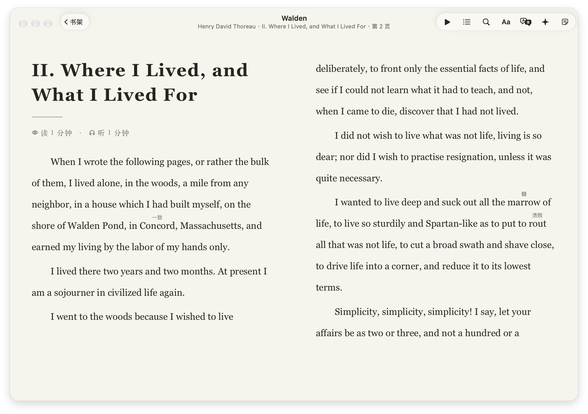
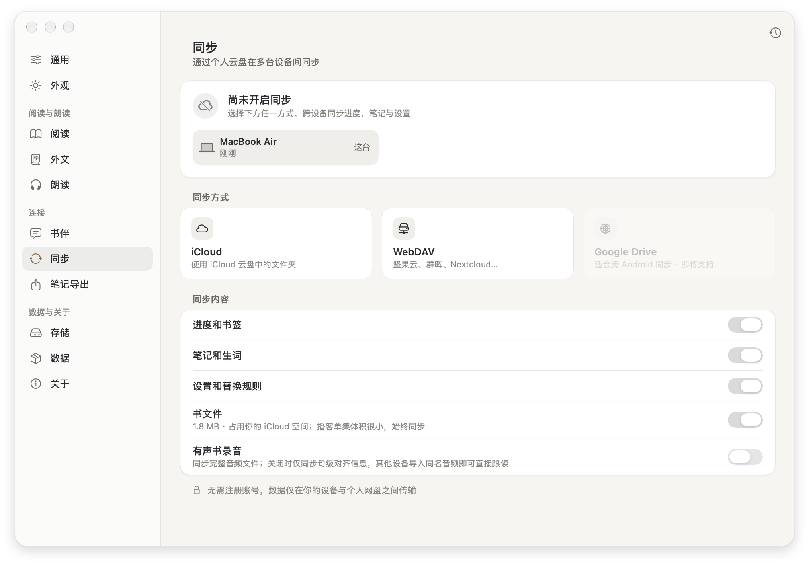

<p align="center">
  
</p>

<h1 align="center">语阅 Yuyue</h1>

<p align="center">
  读书、听书的本地阅读器，支持 Mac、Windows、Android、iPhone 和 iPad。<br />
  没有账号，不用登录，书和笔记都留在你自己的设备上。
</p>

<p align="center">
  <a href="https://cnb.cool/inokoru/yuyue/-/releases">国内高速下载</a> ·
  <a href="https://github.com/inokoru/yuyue/releases">GitHub 下载</a> ·
  <a href="#能做什么">功能一览</a> ·
  <a href="#下载与安装">安装说明</a> ·
  <a href="#给开发者">参与与构建</a> ·
  <a href="LICENSE">GPL-3.0</a>
</p>

<p align="center">
  
</p>

## 能做什么

一本书，可以看、可以听、可以记，三件事对着同一句话。

- **安静地读**  
  支持 EPUB、PDF、TXT、无加密 MOBI / AZW3。内置素白、纸本、纸本·夜、芦苇、铅纸、暗黑等纸张并支持自定义「我的纸」，配有日夜一键切换、独立亮度与「护眼柔光」暖色滤蓝光；支持滑动 / 覆盖阴影 / 无动画三档翻页、自定义翻页音效、上下滚动拉动切章、双栏排版与正则替换规则；可通过局域网 Wi‑Fi 传书、监听文件夹，或连接 OPDS / WebDAV 远程书库（Calibre、Kavita、Komga）。

- **读着听，听着读**  
  点任意一句就从那一句开始朗读，墨线跟着声音逐句推进、自动翻页；支持本机离线语音（Kokoro 32 音色、声音卡与本机声音克隆）、免 Key 微软 Edge 在线神经语音、系统声音与自接云端声音，异常时明确提示而不擅自切声；同时内置双语播客（支持按需加载往期单集）与有声书空间。听到一半拿起来看，正好停在同一行。

- **读外文原著**  
  点词查释义、双击整句翻译，支持「原文 / 双语对照 / 仅译文」三态即时切换与导入 MDict 词典，带生词本与四六级、雅思、GRE 行间难词简注。

- **不剧透的 AI 书伴**  
  可接入端侧模型（Apple 智能）、本机服务（Ollama、LM Studio）或自有大模型 API（DeepSeek、OpenRouter、Claude、OpenAI 等）。隔天打开备好前情提要；随时通过快捷指令总结本章、梳理人物、段落翻译或划词追问，默认只在已读范围内流式作答，每句出处点一下就翻回原句，好回答支持多选一键存进想法。

- **记下来，随时带走**  
  支持多样式划线、随手写想法、今日回顾、年度阅读热力图与书摘卡片。笔记可导出为 Markdown、带划线的 EPUB、CSV，或直发 Obsidian、Notion、flomo、新枝与 Anki。

- **无服务器同步**  
  通过你自己的 iCloud Drive 或 WebDAV（坚果云、群晖、Nextcloud 等）同步进度、笔记与书文件，内置 WebDAV 同步检查视图；遇到冲突并排交给你选，不暗中覆盖，并支持整库 `.yuyue` 快照备份。

<p align="center">
  
  
</p>
<p align="center">
  
  
</p>

### 手机端同样顺手

手机与电脑共用同一套排版与同步内核：支持拖拽定制底部导航与自动记住上次书架标签，在**书、进度、播客、有声与个人合集**之间切换自如；提供书脊与浅木层板书架样式，阅读时支持纸张与字体细调、音量键翻页、双击边缘进出沉浸阅读与墨水屏模式，锁屏与耳机均可控制收听。

<p align="center">
  
  
  
</p>
<p align="center">
  
  
  
</p>

> **在做什么、不做什么**：语阅不做账号系统、自建内容服务器、广告、书城和推荐流；你的书、进度与笔记始终只留在你自己的设备或个人网盘里。为了解功能使用情况，应用默认开启仅记录功能使用形态的匿名统计（不关联个人身份，绝不收集书名、笔记、划线或搜索词），可随时在「关于」页关闭；应用内反馈仅直发给开发者，不公开且不收集邮箱。仓库中围绕有声书自动录音对齐、分角色广播剧配音及书房电台自动编排等进阶能力仍在持续打磨与真机验收中，暂不作为成熟功能过度承诺；具体进度与验收标准见 [ROADMAP.md](ROADMAP.md)。

## 下载与安装

从 [国内高速镜像](https://cnb.cool/inokoru/yuyue/-/releases)（无需登录、大陆直连）或 [GitHub Releases](https://github.com/inokoru/yuyue/releases) 下载。语阅目前不上架应用商店，也没有购买商业代码签名证书，首次安装时会多一两步系统确认。现阶段 **Mac、Windows 和 Android 都可直接下载安装**（均支持应用内检查更新，国内网络优先走镜像源），iPhone 与 iPad 适合愿意自行签名的进阶用户；Linux 桌面端规划见 [ROADMAP.md](ROADMAP.md)。

### Mac（Apple 芯片 / Intel，macOS 14 及以上）

- 直接下载最新版：
  - Apple 芯片（M 系列）：[国内直链](https://cnb.cool/inokoru/yuyue/-/releases/latest/download/Yuyue-mac-arm64.dmg) · [GitHub](https://github.com/inokoru/yuyue/releases/latest/download/Yuyue-mac-arm64.dmg)
  - Intel 芯片：[国内直链](https://cnb.cool/inokoru/yuyue/-/releases/latest/download/Yuyue-mac-x86_64.dmg) · [GitHub](https://github.com/inokoru/yuyue/releases/latest/download/Yuyue-mac-x86_64.dmg)

1. 打开下载好的 `.dmg`，把语阅拖进“应用程序”。
2. 第一次打开会被系统拦下，前往“系统设置 → 隐私与安全性”，点一次“仍要打开”。

API Key 与网盘密码保存在 App 沙盒目录内的本机权限文件中（避免无开发者证书签名更新时反复弹出系统钥匙串授权），仅当前系统账号可读，不进同步、不进快照。

### Windows（64 位 x64 / ARM64，Windows 10 1809 及以上 / Windows 11）

- 直接下载最新版安装程序（x64 推荐）：
  - 安装包（`.exe`）：[国内直链](https://cnb.cool/inokoru/yuyue/-/releases/latest/download/Yuyue-windows-x64-Setup.exe) · [GitHub](https://github.com/inokoru/yuyue/releases/latest/download/Yuyue-windows-x64-Setup.exe)
  - 如需绿色免安装版（`.zip`）或 ARM64 安装包，请在 [国内高速镜像](https://cnb.cool/inokoru/yuyue/-/releases) 或 [GitHub Releases](https://github.com/inokoru/yuyue/releases) 对应版本的附件列表中下载。

1. 双击运行安装程序（默认按当前用户安装，支持 `.epub` / `.mobi` / `.azw3` / `.pdf` / `.m4b` 文件关联与后续应用内检查更新）。
2. 因暂未购买代码签名证书，首次运行若遇 Windows Defender SmartScreen 提示，点「更多信息 → 仍要运行」即可。

API Key 与网盘密码使用 Windows DPAPI（当前用户范围）加密保存在本机，不进同步、不进快照。

### Android（8.0 及以上）

- 直接下载最新版（`.apk`）：[国内直链](https://cnb.cool/inokoru/yuyue/-/releases/latest/download/Yuyue-android.apk) · [GitHub](https://github.com/inokoru/yuyue/releases/latest/download/Yuyue-android.apk)

允许浏览器或文件管理器安装未知来源的应用后即可安装。

### iPhone、iPad（iOS 17 及以上，进阶用户）

- 未签名安装包（`.ipa`）：[国内直链](https://cnb.cool/inokoru/yuyue/-/releases/latest/download/Yuyue-ios-unsigned.ipa) · [GitHub](https://github.com/inokoru/yuyue/releases/latest/download/Yuyue-ios-unsigned.ipa)

需使用 [Impactor](https://github.com/claration/Impactor) 和你自己的 Apple ID 给未签名 `.ipa` 签名安装，或使用 Xcode 从源码编译：

- 免费 Apple ID 签名的应用 **7 天后过期**，需要重新签名；
- 手机需开启开发者模式，并配合电脑操作；
- Impactor 为第三方工具，建议搭配备用 Apple ID 使用；苹果随时可能调整侧载机制，语阅无法保证此方式长期可用。

---

## 给开发者

接下来做什么见 [ROADMAP.md](ROADMAP.md)，怎么参与见 [CONTRIBUTING.md](CONTRIBUTING.md)，多端一致性工程架构见 [docs/dev/multi-platform-architecture.md](docs/dev/multi-platform-architecture.md)。感谢 [LINUX DO](https://linux.do/) 社区的交流与反馈。

<details>
<summary>目录结构与本地构建说明</summary>

### 目录

```text
core/          Rust 核心：导入整理、断句、进度、同步等跨平台逻辑
reader/        书页（TypeScript）：在系统 WebView 中排字、分页与划线高亮
design/        设计参数（颜色、字体等）与各端代码生成脚本
apple/         iPhone、iPad、Mac 客户端（SwiftUI）
android/       Android 客户端（Kotlin + Compose）
windows/       Windows 客户端（WinUI 3 / C#）
shared/        各平台共用资源与图标
fixtures/      测试书籍、跨端共享用例（conformance）与旧版书库样本（legacy）
scripts/       开发、多端一致性审计、快照与打包发布脚本
docs/          功能对照表（parity.yaml）、截图与开发/测试文档（docs/dev/）
e2e/ & tests/  基于 Midscene 的跨端主线与 Windows 正式版视觉 E2E 套件
feedback/      旧版反馈中转脚本（已停用保留，当前反馈方案见 docs/dev/feedback.md）
web/           静态介绍页、下载页与隐私说明
```

### 构建

需要 Rust、Node、pnpm；Apple 端另需 Xcode 与 XcodeGen，Android 端另需 Android SDK 与 NDK（通过 `ANDROID_HOME` 指定），Windows 端另需 .NET 8 SDK 与 Windows App SDK。

```sh
# 书页
cd reader && pnpm install && pnpm build

# Apple
apple/build-core.sh
cd apple && xcodegen

# Android
android/build-core.sh
cd android && ./gradlew assembleDebug

# Windows（在 Windows PowerShell 中运行）
pwsh windows/build-core.ps1 -Debug
dotnet build windows/Yuyue/Yuyue.csproj -p:Platform=x64
```

常用测试与校验：

```sh
cd core && cargo test --workspace --locked
cd reader && pnpm schema:check && pnpm typecheck && pnpm test
node scripts/check-parity.mjs
node scripts/audit-api-parity.mjs
node e2e/midscene/scripts/validate-flows.mjs
node scripts/sync-webdav-e2e.mjs
```

Windows 单元测试：`dotnet test windows/Yuyue.Tests/Yuyue.Tests.csproj -c Release -p:Platform=x64`。界面快照与手动测试说明见 [docs/dev/testing.md](docs/dev/testing.md)。打包发布见 `scripts/package-release.sh`（Mac / iOS / Android）与 `windows/package-release.ps1`（Windows）。

</details>

## 许可

语阅以 [GPL-3.0](LICENSE) 发布，第三方组件和模型的许可见 [NOTICE](NOTICE)。
