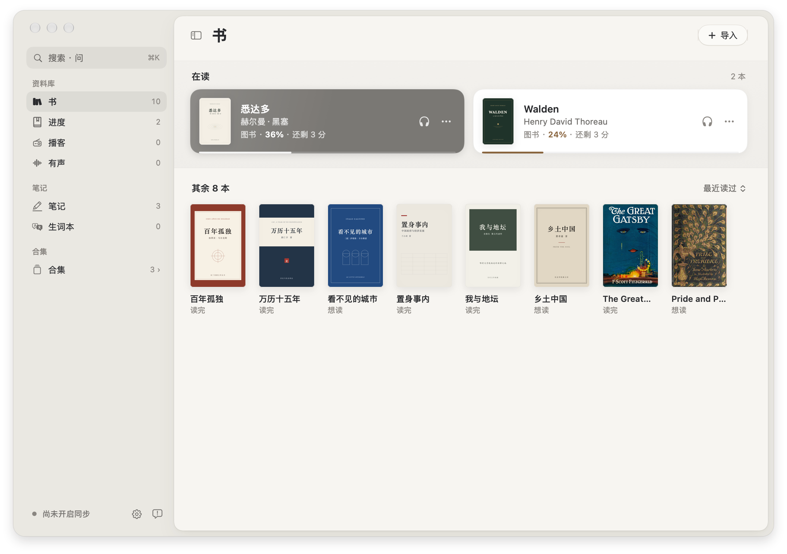
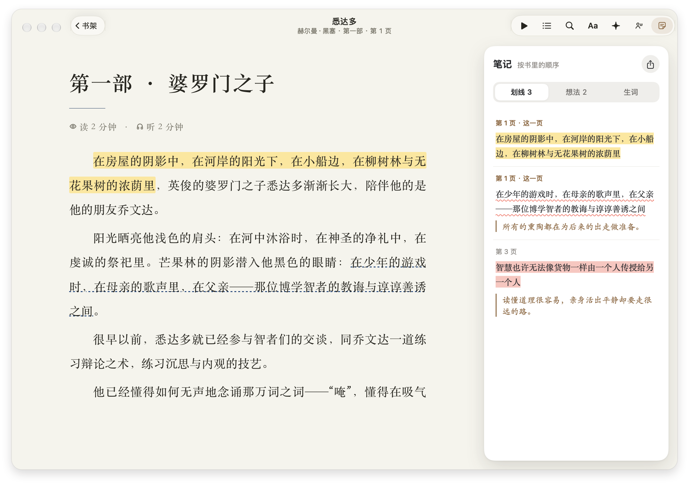
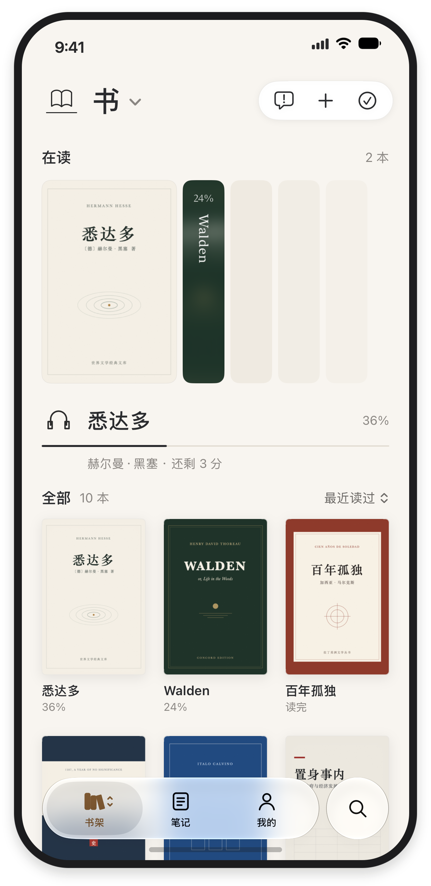
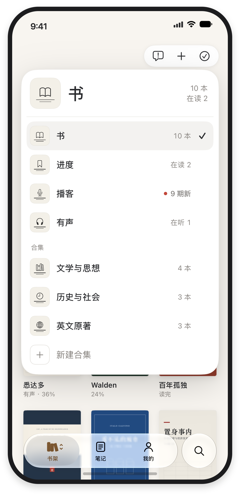
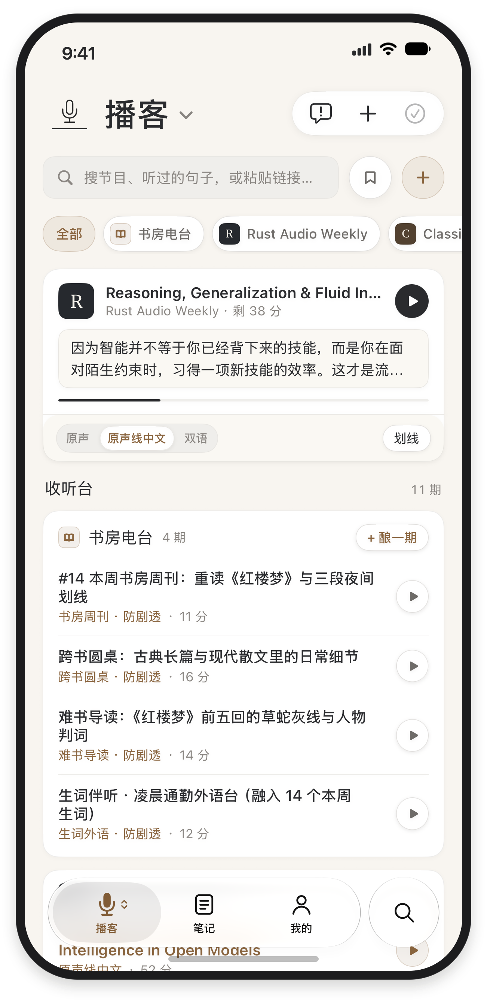
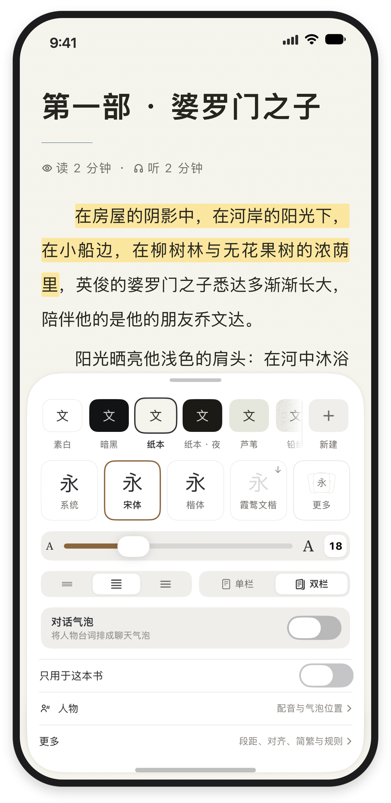

<p align="center">
  
</p>

<h1 align="center">语阅 Yuyue</h1>

<p align="center">
  读书、听书的本地阅读器，支持 Mac、Android、iPhone 和 iPad（Windows 端开发中）。<br />
  没有服务器，不用注册账号，书和笔记都留在你自己的设备上。
</p>

<p align="center">
  <a href="https://github.com/inokoru/yuyue/releases">下载安装包</a> ·
  <a href="#能做什么">功能一览</a> ·
  <a href="#下载与安装">安装说明</a> ·
  <a href="#给开发者">参与与构建</a> ·
  <a href="LICENSE">GPL-3.0</a>
</p>

<p align="center">
  
</p>

## 能做什么

一本书，可以看、可以听、可以记，三件事对着同一句话。

- **安静地读**  
  支持 EPUB、PDF、TXT、MOBI / AZW3。内置素白、纸本、芦苇、铅纸、暗黑等多套纸张，支持双栏排版与正则替换规则；可通过局域网 Wi‑Fi 传书，或连接 OPDS / WebDAV 远程书库（Calibre、Kavita、Komga）。

- **读着听，听着读**  
  点任意一句就从那一句开始朗读，墨线跟着声音逐句推进、自动翻页；支持本机离线声音、系统声音与自接云端声音，同时内置双语播客与有声书空间。听到一半拿起来看，正好停在同一行。

- **读外文原著**  
  点词查释义、双击整句翻译，带生词本与行间难词简注。“书伴”可接入本机模型（Ollama、LM Studio）或自有 API Key，默认只在已读范围内回答，不剧透，每句回答都指回原文。

- **记下来，随时带走**  
  支持多样式划线、随手写想法、今日回顾与书摘卡片。笔记可导出为 Markdown、带划线的 EPUB、CSV，或直发 Obsidian、Notion、flomo、新枝与 Anki。

- **无服务器同步**  
  通过你自己的 iCloud Drive 或 WebDAV（坚果云、群晖、Nextcloud 等）同步进度、笔记与书文件；遇到冲突并排交给你选，不暗中覆盖，并支持整库快照备份。

<p align="center">
  
  
</p>
<p align="center">
  
  
</p>

### 手机端同样顺手

手机与电脑共用同一套排版与同步内核：顶部一处即可在**书、进度、播客、有声与个人合集**之间切换；阅读时支持纸张与字体细调、音量键翻页、双击边缘进出沉浸阅读与墨水屏模式，锁屏与耳机均可控制收听。

<p align="center">
  
  
  
</p>
<p align="center">
  
  
  
</p>

> **在做什么、不做什么**：语阅不做账号系统、自建服务器、数据统计、广告、书城和推荐流。仓库中围绕有声书自动录音对齐、分角色广播剧配音及书房电台自动编排等进阶能力仍在持续打磨与真机验收中，暂不作为成熟功能过度承诺；具体进度与验收标准见 [ROADMAP.md](ROADMAP.md)。

## 下载与安装

从 [GitHub Releases](https://github.com/inokoru/yuyue/releases) 下载。语阅目前不上架应用商店，也没有购买 Apple 开发者签名证书，安装时会多几步。现阶段 **Mac 和 Android 最容易装上**（均支持应用内检查更新），iPhone 与 iPad 仅适合愿意自行签名的进阶用户，**Windows 端正在开发中**。

### Mac（Apple 芯片 / Intel，macOS 14 及以上）

1. 下载对应芯片的 `.dmg`（Apple 芯片选 `arm64`，Intel 芯片选 `x86_64`），打开后把语阅拖进“应用程序”。
2. 第一次打开会被系统拦下，前往“系统设置 → 隐私与安全性”，点一次“仍要打开”。

API Key 与网盘密码保存在 App 沙盒目录内的本机权限文件中（避免无开发者证书签名更新时反复弹出系统钥匙串授权），仅当前系统账号可读，不进同步、不进快照。

### Android（8.0 及以上）

下载 `.apk`，允许浏览器或文件管理器安装未知来源的应用后即可安装。

### iPhone、iPad（iOS 17 及以上，进阶用户）

需使用 [Impactor](https://github.com/claration/Impactor) 和你自己的 Apple ID 给未签名 `.ipa` 签名安装，或使用 Xcode 从源码编译：

- 免费 Apple ID 签名的应用 **7 天后过期**，需要重新签名；
- 手机需开启开发者模式，并配合电脑操作；
- Impactor 为第三方工具，建议搭配备用 Apple ID 使用；苹果随时可能调整侧载机制，语阅无法保证此方式长期可用。

### Windows（开发中）

Windows 端（及 Linux 支持）正在基于现有的 Rust 核心与书页引擎开发推进中，优先覆盖书架、阅读、划线、朗读与跨端同步，详见 [ROADMAP.md](ROADMAP.md)。

---

## 给开发者

接下来做什么见 [ROADMAP.md](ROADMAP.md)，怎么参与见 [CONTRIBUTING.md](CONTRIBUTING.md)。感谢 [LINUX DO](https://linux.do/) 社区的交流与反馈。

<details>
<summary>目录结构与本地构建说明</summary>

### 目录

```text
core/       Rust 核心：导入整理、断句、进度、同步等跨平台逻辑
reader/     书页（TypeScript）：在系统 WebView 中排字、分页与划线高亮
design/     设计参数（颜色、字体等）与各端代码生成脚本
apple/      iPhone、iPad、Mac 客户端（SwiftUI）
android/    Android 客户端（Kotlin + Compose）
windows/    Windows 客户端（WinUI 3 / C#）
shared/     各平台共用资源与图标
fixtures/   测试数据
scripts/    开发、快照与打包脚本
docs/dev/   开发与手动测试说明
feedback/   应用内反馈中转与按需唤醒脚本（见 docs/dev/feedback.md）
web/        静态介绍页与隐私说明
```

### 构建

需要 Rust、Node、pnpm；Apple 端另需 Xcode 与 XcodeGen，Android 端另需 Android SDK 与 NDK（通过 `ANDROID_HOME` 指定），Windows 端（开发中）另需 .NET SDK 与 Windows App SDK。

```sh
# 书页
cd reader && pnpm install && pnpm build

# Apple
apple/build-core.sh
cd apple && xcodegen

# Android
android/build-core.sh
cd android && ./gradlew assembleDebug

# Windows（在 Windows PowerShell 中运行）
pwsh windows/build-core.ps1 -Debug
dotnet build windows/Yuyue/Yuyue.csproj
```

测试：在 `core/` 下运行 `cargo test`，在 `reader/` 下运行 `pnpm test`。界面快照与窗口图册说明见 [docs/dev/testing.md](docs/dev/testing.md)。打包发布文件见 `scripts/package-release.sh`。

</details>

## 许可

语阅以 [GPL-3.0](LICENSE) 发布，第三方组件和模型的许可见 [NOTICE](NOTICE)。
