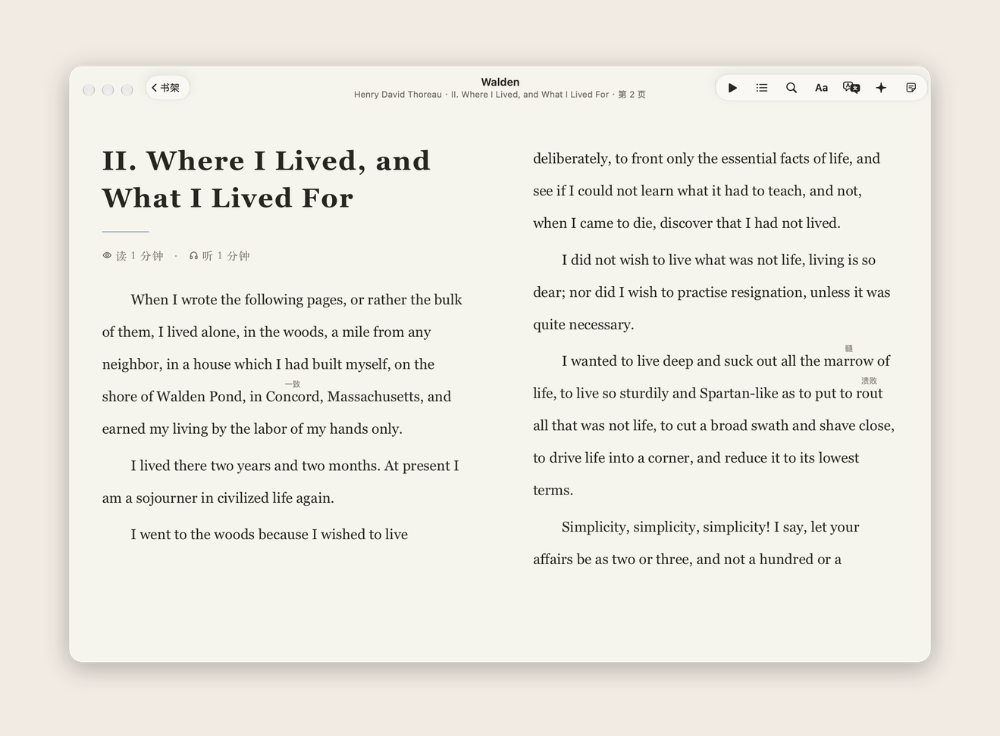

<p align="center">
  
</p>

<h1 align="center">语阅 Yuyue</h1>

<p align="center">
  本地读书、听书。看、听、记对着同一句话。<br />
  没有账号，不用登录，书和笔记都留在你自己的设备上。<br />
  Mac、Windows、Android、iPhone 和 iPad。
</p>

<p align="center">
  <a href="https://cnb.cool/inokoru/yuyue/-/releases">国内高速下载</a> ·
  <a href="https://github.com/inokoru/yuyue/releases">GitHub 下载</a> ·
  <a href="#能做什么">能做什么</a> ·
  <a href="#下载与安装">下载与安装</a> ·
  <a href="#隐私说明">隐私说明</a> ·
  <a href="#给开发者">给开发者</a> ·
  <a href="LICENSE">GPL-3.0</a>
</p>

<!-- readme-shots:begin -->
<p align="center">
  
</p>
<p align="center">
  
</p>
<p align="center">
  
</p>
<!-- readme-shots:end -->

<!-- readme-shots:phones:begin -->
<p align="center">
  
</p>
<p align="center">
  
</p>
<!-- readme-shots:phones:end -->

## 能做什么

- **看**  
  在同一页上读。纸张、亮度和翻页可以自己调；外文可以点词、译一句。

- **听**  
  从这一句开始念，墨线跟着声音走，自动翻页。听到一半拿起来看，还停在这一行。

- **记**  
  划下来，写一句想法。笔记能导出，也能交到你自己的笔记软件里。

- **同步**  
  用你自己的 iCloud 或 WebDAV，在设备之间同步进度、笔记和书。两边改了同一处，并排给你选，不暗中覆盖。

<details>
<summary>格式、声音、笔记和同步的细节</summary>

**看。** EPUB、PDF、TXT，以及无加密的 MOBI / AZW3。纸张有素白、纸本、纸本·夜、芦苇、铅纸、暗黑，也可以做一张「我的纸」；日夜切换、单独亮度、「护眼柔光」。翻页有滑动、覆盖阴影、无动画，可以自己换翻页声；上下滚动拉到底能切章，可以双栏，也可以用正则替换。传书可以走局域网 Wi‑Fi、监听一个文件夹，或连接 OPDS / WebDAV 远程书库（Calibre、Kavita、Komga）。外文点词查释义，双击整句翻译，原文 / 双语对照 / 仅译文可以当场换；能导入 MDict，有生词本，以及四六级、雅思、GRE 的行间简注。

**听。** 本机离线语音（Kokoro 32 音色、声音卡、本机声音克隆）、免 Key 的微软 Edge 在线神经语音、系统声音，或你自己接的云端声音。出错时说明原因，不擅自换一声。另有双语播客（往期单集按需加载）和有声书空间。

**书伴。** 可以接端侧模型（Apple 智能）、本机服务（Ollama、LM Studio），或你自己的大模型 API（DeepSeek、OpenRouter、Claude、OpenAI 等）。隔天打开可以有前情提要；总结本章、梳理人物、译一段、划词追问，默认只在已读范围内回答，出处点一下回到那一句。

**记。** 几种划线、随手的想法、今日回顾、一年的阅读热力图、书摘卡片。导出为 Markdown、带划线的 EPUB、CSV，或发到 Obsidian、Notion、flomo、新枝、Anki。

**同步。** iCloud Drive，或 WebDAV（坚果云、群晖、Nextcloud 等），带一个 WebDAV 同步检查视图。也可以把整库打成一份 `.yuyue` 快照。

**手机。** 和电脑同一套排版与同步。底部导航可以拖，会记住上次的书架标签；书、进度、播客、有声和个人合集之间切换。书架可以是书脊或浅木层板。阅读时能调纸张和字体，音量键翻页，双击边缘进出沉浸阅读，有墨水屏模式。锁屏和耳机可以控制收听。

有声书的自动录音对齐、分角色广播剧，以及书房电台的自动编排，还在打磨和真机验收里，这里不把它们说成已经做好。进度见 [ROADMAP.md](ROADMAP.md)。

</details>

## 不做什么

不做账号，不做广告，不做书城和推荐，也不自己搭一台内容服务器。书、进度和笔记只在你的设备上，或在你自己的网盘里。

## 下载与安装

从 [国内高速镜像](https://cnb.cool/inokoru/yuyue/-/releases)（不用登录，大陆可直连）或 [GitHub Releases](https://github.com/inokoru/yuyue/releases) 下载。语阅不上架应用商店，也没有购买商业代码签名证书，所以第一次打开时，系统会让你再确认一次。

Mac、Windows 和 Android 可以直接装，也能在应用里检查更新；国内网络先走镜像。iPhone 和 iPad 需要自己签名。Linux 桌面端见 [ROADMAP.md](ROADMAP.md)。

### Mac（Apple 芯片 / Intel，macOS 14 及以上）

- Apple 芯片（M 系列）：[国内直链](https://cnb.cool/inokoru/yuyue/-/releases/latest/download/Yuyue-mac-arm64.dmg) · [GitHub](https://github.com/inokoru/yuyue/releases/latest/download/Yuyue-mac-arm64.dmg)
- Intel 芯片：[国内直链](https://cnb.cool/inokoru/yuyue/-/releases/latest/download/Yuyue-mac-x86_64.dmg) · [GitHub](https://github.com/inokoru/yuyue/releases/latest/download/Yuyue-mac-x86_64.dmg)

1. 打开 `.dmg`，把语阅拖进「应用程序」。
2. 第一次会被系统拦住。到「系统设置 → 隐私与安全性」，点一次「仍要打开」。

API Key 和网盘密码放在 App 沙盒里的本机权限文件中（没有开发者证书时，这样更新不会反复弹出钥匙串授权）。只有当前系统账号能读，不进同步，不进快照。

### Windows（64 位 x64 / ARM64，Windows 10 1809 及以上 / Windows 11）

- 安装包（x64，`.exe`）：[国内直链](https://cnb.cool/inokoru/yuyue/-/releases/latest/download/Yuyue-windows-x64-Setup.exe) · [GitHub](https://github.com/inokoru/yuyue/releases/latest/download/Yuyue-windows-x64-Setup.exe)
- 免安装的 `.zip`，或 ARM64 安装包，在[国内高速镜像](https://cnb.cool/inokoru/yuyue/-/releases)或 [GitHub Releases](https://github.com/inokoru/yuyue/releases) 该版本的附件里。

1. 双击安装程序。默认装给当前用户，可关联 `.epub` / `.mobi` / `.azw3` / `.pdf` / `.m4b`，之后能在应用里检查更新。
2. 还没有代码签名证书。若 Windows Defender SmartScreen 拦住，点「更多信息 → 仍要运行」。

API Key 和网盘密码用 Windows DPAPI（当前用户）加密后留在本机，不进同步，不进快照。

### Android（8.0 及以上）

- 安装包（`.apk`）：[国内直链](https://cnb.cool/inokoru/yuyue/-/releases/latest/download/Yuyue-android.apk) · [GitHub](https://github.com/inokoru/yuyue/releases/latest/download/Yuyue-android.apk)

在浏览器或文件管理器里允许安装未知来源的应用，然后安装。

### iPhone、iPad（iOS 17 及以上）

- 未签名安装包（`.ipa`）：[国内直链](https://cnb.cool/inokoru/yuyue/-/releases/latest/download/Yuyue-ios-unsigned.ipa) · [GitHub](https://github.com/inokoru/yuyue/releases/latest/download/Yuyue-ios-unsigned.ipa)

用 [Impactor](https://github.com/claration/Impactor) 和你自己的 Apple ID 给未签名 `.ipa` 签名后再装，也可以用 Xcode 从源码编译。

- 免费 Apple ID 签名的应用 **7 天后过期**，要重新签名。
- 手机要打开开发者模式，并且用电脑操作。
- Impactor 是第三方工具，建议用一个备用 Apple ID。苹果可能调整侧载，语阅不能保证这种方式一直能用。

## 隐私说明

为了知道功能被怎样使用，语阅默认开启匿名的使用形态统计。它不关联个人身份，不收集书名、笔记、划线或搜索词。可以在「关于」里关掉。

应用里写的反馈只发给开发者，不公开，也不收集邮箱。

## 给开发者

<details>
<summary>目录、构建和测试</summary>

接下来做什么见 [ROADMAP.md](ROADMAP.md)，怎么参与见 [CONTRIBUTING.md](CONTRIBUTING.md)，多端一致性见 [docs/dev/multi-platform-architecture.md](docs/dev/multi-platform-architecture.md)。感谢 [LINUX DO](https://linux.do/) 社区的交流与反馈。

README 截图和宣传短片的采集见 [docs/dev/readme-screenshots.md](docs/dev/readme-screenshots.md)。

### 目录

```text
core/          Rust 核心：导入整理、断句、进度、同步等跨平台逻辑
reader/        书页（TypeScript）：在系统 WebView 中排字、分页与划线高亮
design/        设计参数（颜色、字体等）与各端代码生成脚本
apple/         iPhone、iPad、Mac 客户端（SwiftUI）
android/       Android 客户端（Kotlin + Compose）
windows/       Windows 客户端（WinUI 3 / C#）
shared/        各平台共用资源与图标
fixtures/      测试书籍、跨端共享用例（conformance）与旧版书库样本（legacy）
scripts/       开发、审计、打包，以及 README 截图与宣传短片（docs/dev/readme-screenshots.md）
docs/          功能对照表（parity.yaml）、截图与开发/测试文档（docs/dev/）
e2e/ & tests/  基于 Midscene 的跨端主线与 Windows 正式版视觉 E2E 套件
feedback/      旧版反馈中转脚本（已停用保留，当前反馈方案见 docs/dev/feedback.md）
web/           静态介绍页、下载页与隐私说明
```

### 构建

需要 Rust、Node、pnpm；Apple 端另需 Xcode 与 XcodeGen，Android 端另需 Android SDK 与 NDK（通过 `ANDROID_HOME` 指定），Windows 端另需 .NET 8 SDK 与 Windows App SDK。

```sh
# 书页
cd reader && pnpm install && pnpm build

# Apple
apple/build-core.sh
cd apple && xcodegen

# Android
android/build-core.sh
cd android && ./gradlew assembleDebug

# Windows（在 Windows PowerShell 中运行）
pwsh windows/build-core.ps1 -Debug
dotnet build windows/Yuyue/Yuyue.csproj -p:Platform=x64
```

常用测试与校验：

```sh
cd core && cargo test --workspace --locked
cd reader && pnpm schema:check && pnpm typecheck && pnpm test
node scripts/check-parity.mjs
node scripts/audit-api-parity.mjs
node e2e/midscene/scripts/validate-flows.mjs
node scripts/sync-webdav-e2e.mjs
```

Windows 单元测试：`dotnet test windows/Yuyue.Tests/Yuyue.Tests.csproj -c Release -p:Platform=x64`。界面快照与手动测试说明见 [docs/dev/testing.md](docs/dev/testing.md)。打包发布见 `scripts/package-release.sh`（Mac / iOS / Android）与 `windows/package-release.ps1`（Windows）。

</details>

## 许可

语阅以 [GPL-3.0](LICENSE) 发布，第三方组件和模型的许可见 [NOTICE](NOTICE)。
